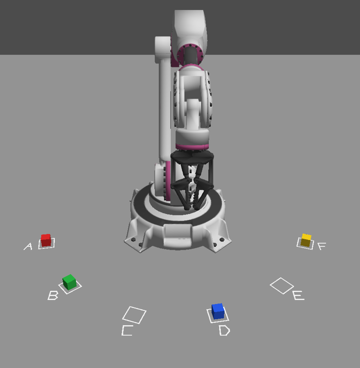
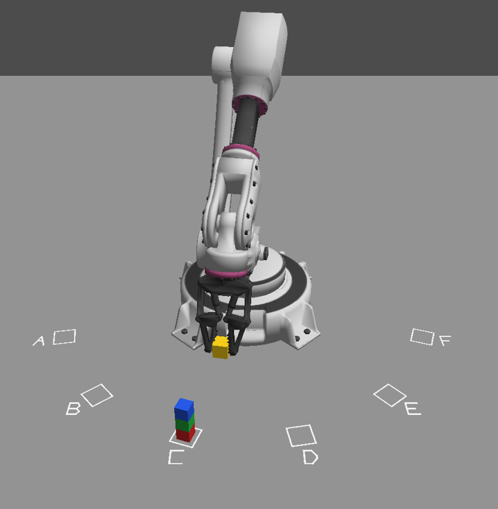

# Anthropomorphic Robot Arm Simulation

[](https://github.com/praha6248/Robot_arm/actions/workflows/ci.yml)


🇵🇱 [Wersja polska](README.pl.md)


A 6-axis robot arm with a gripper, simulated in C++/OpenGL. The robot moves coloured blocks between
slots on the floor: it grips them with its fingers, carries them, puts them down on the floor or on
other blocks, and builds towers. It can be driven from the keyboard or with a text-based
**robot language** (e.g. `MOVE red C`) over the console or a TCP socket.

> **Natural-language** control ("put the red block on the blue one") with a local language model
> lives in the fork: **[praha6248/Robot_arm-nl](https://github.com/praha6248/Robot_arm-nl)**.

| Initial scene | Building a tower |
|---|---|
|  |  |

## Features

- **Arm model**: base, shoulder, elbow, wrist, gripper rotation and fingers, loaded from textured OBJ files.
- **Inverse kinematics**: analytic. Base rotation + a two-link planar manipulator, gripper always
  pointing down; every solution is verified with forward kinematics and joint limits.
- **Contact-based grasping**: a block is grasped only when the fingertips actually close on it; the
  fingers stop at the block's width (contact angle computed from the finger geometry).
- **Gravity and stacking**: a released block falls and lands on the floor or on the block below;
  unsupported blocks fall; a covered block cannot be picked up.
- **Motion planning**: travel at a safe height above the tallest tower, an arc around the base,
  vertical approach and retreat, grasp verification.
- **Robot language**: text commands over the console or TCP, with a reply once the motion is finished.
- **Teaching by demonstration**: record and replay keyboard-driven motions.

## Building

Requirements: C++17 compiler, CMake ≥ 3.16, OpenGL, GLFW 3, glm.

```bash
sudo apt install build-essential cmake libglfw3-dev libglm-dev   # or without root: ./scripts/setup_deps.sh
cmake -S . -B build
cmake --build build -j
```

`scripts/setup_deps.sh` downloads the glm/GLFW headers and the GLFW library into `third_party/`,
which is handy without admin rights. The OpenGL loader (glad) is included in the repository, and
assimp is no longer needed.

## Running

```bash
./build/robot_arm
```

The program can be started from any directory (models are loaded relative to the project directory).

### Keyboard and mouse

| Key | Action |
|---|---|
| `Q` / `A` | base rotation |
| `W` / `S` | shoulder |
| `E` / `D` | elbow |
| `R` / `F` | wrist (gripper pitch) |
| `T` / `G` | gripper rotation |
| `Y` / `H` | open / close fingers (closing on a block = grasp) |
| `M` / `N` / `B` | start recording / stop / play back motion |
| `K` | restore the initial block layout |
| mouse (LMB + drag), wheel | rotate camera, zoom |

## Robot language

One command per line (case-insensitive). Commands can be typed in the terminal running the
simulation or sent to `127.0.0.1:5555` (port: `ROBOT_PORT` environment variable). The `OK ...` reply
arrives **after the motion has finished**; `ERR <reason>` is returned when a command cannot be executed.

| Command | Action |
|---|---|
| `PICK <block>` | move above the block, descend, close fingers, lift |
| `PLACE <slot>` | put the held block on slot `A`–`F` (on top of whatever is there) |
| `PLACE_ON <block>` | put the held block on another block |
| `MOVE <block> <slot\|block>` | `PICK` + `PLACE`/`PLACE_ON` in one step |
| `HOME` | rest position |
| `OPEN` / `CLOSE` | open / close fingers |
| `GOTO <x> <y> <z>` | move the grasp point (gripper pointing down) |
| `STATE` | scene state as JSON (blocks, what they rest on, towers on slots) |
| `RESET` | initial block layout |
| `SPEED <deg/s>` | joint speed |
| `SCREENSHOT <file.png>` | save a screenshot |
| `HELP` | list of commands |

Blocks: `red`, `green`, `blue`, `yellow` (Polish names also work: `czerwony`, `zielony`, `niebieski`, `zolty`).
Slots: `A`–`F` from left to right (as seen from the default camera).

Example: a three-block tower.

```bash
printf 'MOVE red C\nMOVE green red\nMOVE blue green\nHOME\n' | nc -q 30 127.0.0.1 5555
```

```
OK przeniesiono red na c
OK przeniesiono green na red
OK przeniesiono blue na green
OK home
```

Errors are detected before any motion starts, e.g. `PICK red` while green lies on red →
`ERR na klocku red lezy green` ("green is lying on red"). Replies are in Polish.

## How it works

```
 command ──► CommandServer (TCP/stdin thread) ──► RobotLanguage (validation + motion plan)
                                                          │ motion queue
                                                          ▼
                 World (blocks, grasping, gravity) ◄── RobotArm (IK, joint interpolation)
                                                          │
                                                          ▼
                                                   OpenGL rendering
```

- `RobotArm`: forward kinematics (the same matrices as used for rendering), IK, motion queue
  (joint moves, straight-line moves of the grasp point, fingers, pauses, callbacks).
- `World`: blocks and slots, grasp detection from finger contact, falling and landing.
- `RobotLanguage`: command parser, trajectory planning, `STATE` as JSON.
- `CommandServer`: TCP server and console; commands run one at a time on the OpenGL thread.

## Tests

Kinematics, world physics and the robot language are built as a separate library without OpenGL
(`robot_core`), so they can be tested headless:

```bash
cmake -S . -B build -DROBOT_BUILD_TESTS=ON
cmake --build build
ctest --test-dir build --output-on-failure
```

The GoogleTest suite covers:

- **kinematics**: IK → FK round trip over the whole workspace with joint-limit checks, vertical
  gripper orientation, rejection of unreachable targets;
- **world**: initial layout, all blocks reachable, unsupported blocks falling to the floor;
- **robot language (end-to-end over TCP)**: moving a block to a free slot, stacking a three-block
  tower, refusing to pick a covered block or a second block, `PICK`/`PLACE`/`RESET`, `STATE` JSON,
  and error replies for invalid commands.

GitHub Actions builds the simulator and runs the tests with GCC and Clang on every push.

## Project layout

```
main.cpp            window, rendering, main loop
RobotArm.*          joints, kinematics, motion
World.*             blocks, slots, grasp physics
RobotLanguage.*     robot language
CommandServer.*     TCP + console
ObjMesh.*           OBJ loading
tests/              headless unit tests (GoogleTest)
parts/              models and textures
scripts/            dependency download without root
```
