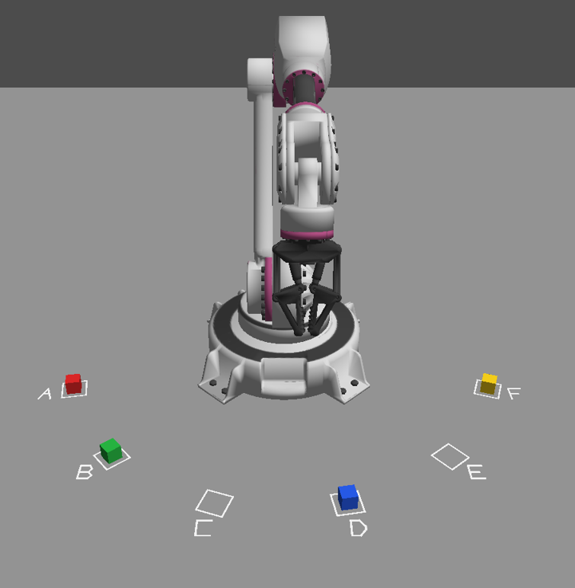
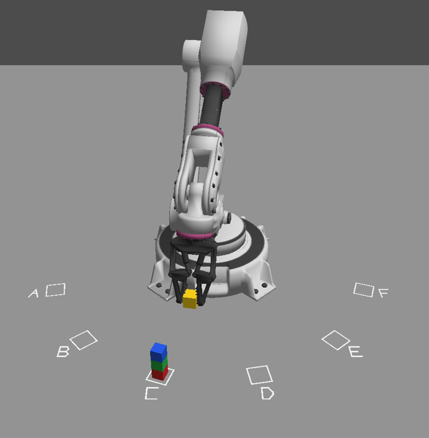

# Symulacja ramienia robota antropomorficznego

🇬🇧 [English version](README.md)


Symulacja 6-osiowego ramienia robota z chwytakiem w C++/OpenGL. Robot przekłada kolorowe klocki
między polami na podłodze: chwyta je palcami, przenosi, odkłada na podłogę albo na inne klocki
i buduje z nich wieże. Można nim sterować z klawiatury albo tekstowym **językiem robota**
(np. `MOVE red C`) przez konsolę lub gniazdo TCP.

> Sterowanie w **języku naturalnym** („połóż czerwony klocek na niebieskim”) z lokalnym modelem
> językowym jest w forku: **[praha6248/Robot_arm-nl](https://github.com/praha6248/Robot_arm-nl)**.

| Scena startowa | Budowanie wieży |
|---|---|
|  |  |

## Funkcje

- **Model ramienia** – podstawa, bark, łokieć, nadgarstek, obrót chwytaka i palce, wczytywane z plików OBJ z teksturami.
- **Kinematyka odwrotna** – analityczna: obrót podstawy + dwuczłonowy manipulator płaski, chwytak zawsze skierowany w dół; każde rozwiązanie sprawdzane kinematyką prostą i limitami stawów.
- **Chwytanie przez kontakt** – klocek zostaje chwycony tylko wtedy, gdy opuszki palców faktycznie zamkną się na nim; palce zatrzymują się na szerokości klocka (kąt kontaktu liczony z geometrii palców).
- **Grawitacja i układanie** – puszczony klocek spada i ląduje na podłodze albo na klocku pod spodem; klocki bez podparcia spadają; przykrytego klocka nie da się podnieść.
- **Planowanie ruchu** – przelot na bezpiecznej wysokości nad najwyższą wieżą, łuk wokół podstawy, pionowy zjazd i odjazd, kontrola chwytu.
- **Język robota** – komendy tekstowe przez konsolę lub TCP, odpowiedź po wykonaniu ruchu.
- **Uczenie przez demonstrację** – nagrywanie i odtwarzanie ruchów z klawiatury.

## Budowanie

Wymagania: kompilator C++17, CMake ≥ 3.16, OpenGL, GLFW 3, glm.

```bash
sudo apt install build-essential cmake libglfw3-dev libglm-dev   # albo bez roota: ./scripts/setup_deps.sh
cmake -S . -B build
cmake --build build -j
```

`scripts/setup_deps.sh` pobiera nagłówki glm/GLFW i bibliotekę GLFW do `third_party/` – przydaje się,
gdy nie ma uprawnień administratora. Loader OpenGL (glad) jest w repozytorium, a assimp nie jest już potrzebny.

## Uruchomienie

```bash
./build/robot_arm
```

Program można uruchomić z dowolnego katalogu (modele są wczytywane względem katalogu projektu).

### Klawiatura i mysz

| Klawisz | Działanie |
|---|---|
| `Q` / `A` | obrót podstawy |
| `W` / `S` | bark |
| `E` / `D` | łokieć |
| `R` / `F` | nadgarstek (pochylenie chwytaka) |
| `T` / `G` | obrót chwytaka |
| `Y` / `H` | otwieranie / zamykanie palców (zamknięcie na klocku = chwyt) |
| `M` / `N` / `B` | start nagrywania / stop / odtwarzanie ruchu |
| `K` | przywrócenie początkowego ułożenia klocków |
| mysz (LPM + ruch), kółko | obrót kamery, przybliżenie |

## Język robota

Jedna komenda w linii (wielkość liter nie ma znaczenia). Można je wpisywać w terminalu, w którym
działa symulacja, albo wysyłać na `127.0.0.1:5555` (port: zmienna `ROBOT_PORT`). Odpowiedź
`OK ...` przychodzi **po zakończeniu ruchu**, a `ERR <powód>` – gdy komenda jest niewykonalna.

| Komenda | Działanie |
|---|---|
| `PICK <klocek>` | podjedź nad klocek, zjedź, zamknij palce, podnieś |
| `PLACE <pole>` | odłóż trzymany klocek na pole `A`–`F` (na wierzch tego, co tam leży) |
| `PLACE_ON <klocek>` | odłóż trzymany klocek na inny klocek |
| `MOVE <klocek> <pole\|klocek>` | `PICK` + `PLACE`/`PLACE_ON` w jednym |
| `HOME` | pozycja spoczynkowa |
| `OPEN` / `CLOSE` | otwórz / zamknij palce |
| `GOTO <x> <y> <z>` | przesuń punkt chwytu (chwytak w dół) |
| `STATE` | stan sceny jako JSON (klocki, na czym leżą, wieże na polach) |
| `RESET` | początkowe ułożenie klocków |
| `SPEED <deg/s>` | prędkość stawów |
| `SCREENSHOT <plik.png>` | zrzut ekranu |
| `HELP` | lista komend |

Klocki: `red`, `green`, `blue`, `yellow` (albo polskie nazwy: `czerwony`, `zielony`, `niebieski`, `zolty`).
Pola: `A`–`F` od lewej do prawej (patrząc z domyślnej kamery).

Przykład – wieża z trzech klocków:

```bash
printf 'MOVE red C\nMOVE green red\nMOVE blue green\nHOME\n' | nc -q 30 127.0.0.1 5555
```

```
OK przeniesiono red na c
OK przeniesiono green na red
OK przeniesiono blue na green
OK home
```

Błędy są wykrywane przed ruchem, np. `PICK red` gdy na czerwonym leży zielony →
`ERR na klocku red lezy green`.

## Jak to działa

```
 komenda ──► CommandServer (wątek TCP/stdin) ──► RobotLanguage (walidacja + plan ruchu)
                                                          │ kolejka ruchów
                                                          ▼
                     World (klocki, chwyt, grawitacja) ◄── RobotArm (IK, interpolacja stawów)
                                                          │
                                                          ▼
                                                   render OpenGL
```

- `RobotArm` – kinematyka prosta (te same macierze co przy rysowaniu), IK, kolejka ruchów
  (ruchy stawów, ruchy prostoliniowe punktu chwytu, palce, pauzy, wywołania zwrotne).
- `World` – klocki i pola, wykrywanie chwytu po kontakcie palców, spadanie i lądowanie.
- `RobotLanguage` – parser komend, planowanie trajektorii, `STATE` w JSON.
- `CommandServer` – serwer TCP i konsola, komendy wykonywane po kolei w wątku OpenGL.

## Testy

```bash
cmake -S . -B build -DROBOT_BUILD_TESTS=ON
cmake --build build && ctest --test-dir build --output-on-failure
```

Testy (GoogleTest) działają bez okna: sprawdzają IK/FK w całej przestrzeni roboczej, fizykę klocków
oraz komendy języka robota wysyłane przez TCP (przenoszenie, wieże, błędy). Uruchamia je GitHub Actions.

## Struktura

```
main.cpp            okno, renderowanie, pętla główna
RobotArm.*          stawy, kinematyka, ruch
World.*             klocki, pola, fizyka chwytu
RobotLanguage.*     język robota
CommandServer.*     TCP + konsola
ObjMesh.*           wczytywanie OBJ
parts/              modele i tekstury
scripts/            pobieranie zależności bez roota
```
